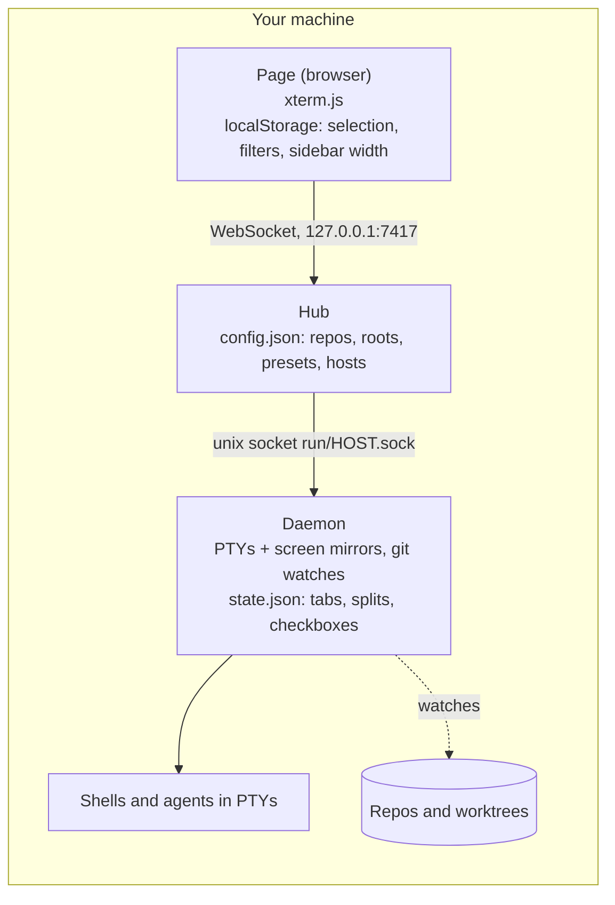
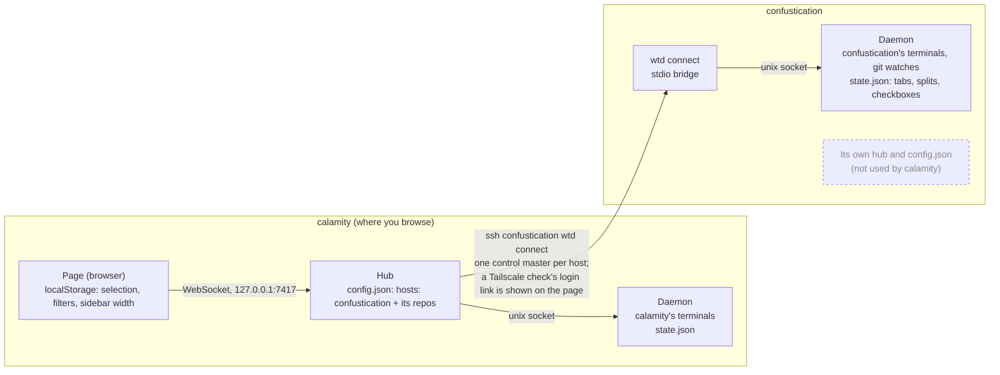

# worktree-term

A fast, worktree-centric terminal manager for coding agents. One tab per repo (local or over SSH), every git worktree in a sidebar, and persistent terminals per worktree that outlive the UI.

The CLI is `wtd`: a daemon per host owns the PTYs and git watches, and a local hub serves the browser UI and reaches every daemon over one protocol. See `architecture/` for the structure and its principles.

## Architecture

Three running components, all started from the one `wtd` binary:

| Component | Runs | Owns |
| --- | --- | --- |
| Daemon (`wtd daemon`) | One per host, independent of any page or hub | The PTYs and their screen mirrors, git worktree watches, and `~/.local/state/worktree-term/state.json`: each worktree's terminal tabs, splits, active tab and checkbox |
| Hub (`wtd hub`, started by `wtd ui`) | One on the machine you browse from | `~/.config/worktree-term/config.json` (repos, roots, presets, hosts); nothing else |
| Page | The browser | Rendering (xterm.js) and view preferences in `localStorage`: selected repo, selected worktree per repo, "checked only" filter, name search, sidebar width |

- **The browser talks only to the hub**: the hub serves the page and one WebSocket per page, on `127.0.0.1` only.
- **The daemon manages the terminals.** A terminal lives until it is closed or its worktree removed; closing the page or restarting the hub does not end it.
- **Tabs and splits are persisted by the daemon** of the host the worktree is on, so every page sees the same layout. View preferences stay in each browser.
- For each page, the hub holds one link per host: the daemon's owner-only unix socket locally, `ssh <alias> "$HOME/.local/bin/wtd" connect` remotely. `wtd connect` only bridges SSH's stdio to the remote daemon's socket, starting the daemon if needed.

### One machine



### Two machines over SSH

The browser and hub run on `calamity`; `confustication` contributes only its daemon. A hub's repo tabs, including a remote host's, come from its own `config.json`, so a hub on `confustication` plays no part.



## Installation

Requires Linux and Node 20 or later. From a checkout, `pnpm build`, then:

```sh
node dist/wtd.mjs install-local            # this machine
node dist/wtd.mjs install-local --systemd  # also run the daemon as a systemd user unit
```

An installed `wtd` reinstalls itself the same way: `wtd install-local` or `wtd install-local --systemd`.

`wtd install-local` copies the bundle into a new release under `~/.local/share/worktree-term/versions/`, points `~/.local/share/worktree-term/current` at it, writes the shim `~/.local/bin/wtd` (bound to the Node that ran the installer) and a desktop launcher, `~/.local/share/applications/worktree-term.desktop`, that runs `wtd ui`. Reinstalling keeps the previous release, so running daemons and hubs keep working; older releases are removed. Run it again after moving Node.

With `--systemd` it also writes `~/.config/systemd/user/worktree-term-daemon.service`, enables it and starts it unless a daemon already runs; from then on every auto-start of the daemon goes through `systemctl --user start`. A unit's daemon stops when your last session ends unless lingering is on: `loginctl enable-linger`.

## Configuration

The hub reads `$XDG_CONFIG_HOME/worktree-term/config.json` (by default `~/.config/worktree-term/config.json`); every key is optional, and a new browser session picks up edits. `presets` lists the terminals a new tab or split can start, in order: `command` runs as `$SHELL -l -i -c <command>`, and `null` starts the plain login shell. Without `presets`, they are `shell` (the login shell), `claude` and `codex`. "+ Add preset" and the × beside each preset in the picker edit `presets` here, starting from those defaults; every open page shows the change.

`repos` and `roots` belong to this machine: `repos` are the repo tabs (absolute or `~/…`), `roots` are where "Add repo" looks for repositories, 3 levels deep (default `["~"]`). `hosts` lists remote hosts, each shown after this machine's repos: `name` labels its tabs (`name:repo`), `ssh` is the SSH alias, `repos` must be absolute paths on that host, and its `roots` (`~` meaning the remote home) default to `["~"]`. "Add repo" and "Remove repo" on the page edit `repos` here, keeping everything else as written.

```json
{
  "port": 7417,
  "repos": ["~/src/app", "/srv/lib"],
  "roots": ["~/src"],
  "presets": [
    { "name": "claude", "command": "claude" },
    { "name": "shell", "command": null }
  ],
  "hosts": [{ "name": "devbox", "ssh": "devbox", "repos": ["/home/me/src/api"], "roots": ["~/src"] }]
}
```

## Remote hosts

A remote host needs only Linux, Node 20 or later and an SSH alias that logs in without a prompt (keys or an agent: the hub runs SSH with `BatchMode=yes`). Install wtd there with

```sh
wtd install-remote devbox                 # finds Node on the remote PATH or in its login shell
wtd install-remote devbox --node /opt/node22/bin/node
```

or with "Install" on the page while the host is down. The remote gets the same layout as `wtd install-local`, without launcher or unit. Its shim runs the Node found at install time, so `"$HOME/.local/bin/wtd" connect` works over plain `ssh` with no dotfile changes.

Each browser session holds one `ssh <alias> "$HOME/.local/bin/wtd" connect` per remote host, multiplexed over one SSH control master per host (`ControlPersist=10m`); a lost link reconnects to the same daemon and keeps its terminals. A host that keeps failing shows as down with SSH's last error line. A host reached over Tailscale SSH whose check has expired shows "needs Tailscale login" with an "Open login link" button; approving the check there connects every open page. sshd's `MaxSessions` (default 10) caps the sessions of one master: each open page uses one per host, plus a brief one for each "Add repo" or "Remove repo". When a host's running daemon speaks an older daemon protocol than its installed `wtd` (whose protocol `wtd --version` prints; it does not ask the running daemon), the page offers "Restart daemon" (this machine) or "Reinstall & restart" (a remote host), naming the terminals that will be killed. `WTD_SSH` replaces the `ssh` program.

## Keyboard

| Keys                        | Action                                                    |
| --------------------------- | --------------------------------------------------------- |
| Alt+Up / Alt+Down           | Previous / next worktree in the sidebar, under its filter |
| Alt+Left / Alt+Right        | Previous / next terminal tab                              |
| Alt+Shift+arrows            | Focus the pane in that direction                          |
| Ctrl+Shift+T                | New tab                                                   |
| Ctrl+Shift+D / Ctrl+Shift+E | Split the focused pane right / down                       |
| Ctrl+Shift+W                | Close the focused pane                                    |
| Ctrl+Shift+C / Ctrl+Shift+V | Copy the selection / paste                                |

The preset picker takes 1–9, the arrow keys and Enter, and Escape cancels it.

## Attention marks

Panes, terminal tabs, worktree rows and repo tabs show the most urgent mark of their terminals: needs input, exited with failure, exited, done (quiet after unseen output) and new output. A terminal needs input when its program rings the bell or sends a desktop notification (OSC 9, OSC 777 `notify` or OSC 99). Claude Code does so only when told to; put this in `~/.claude/settings.json`:

```json
{ "preferredNotifChannel": "terminal_bell" }
```

## Development

Requires Node 22 (`.nvmrc`), pnpm, and the `la-*` architecture tools on `PATH` (`uv tool install living-architecture==0.3.1`), which `pnpm test` runs.

```sh
pnpm install
pnpm build              # dist/wtd.mjs and dist/web
pnpm dev                # the page through Vite with hot reload, at http://127.0.0.1:5173/login; needs a running hub
pnpm test               # unit, process, architecture and e2e tiers
pnpm test:integration   # opt-in real-SSH tests
pnpm lint               # tsc -b and ESLint
pnpm format             # Prettier
```
