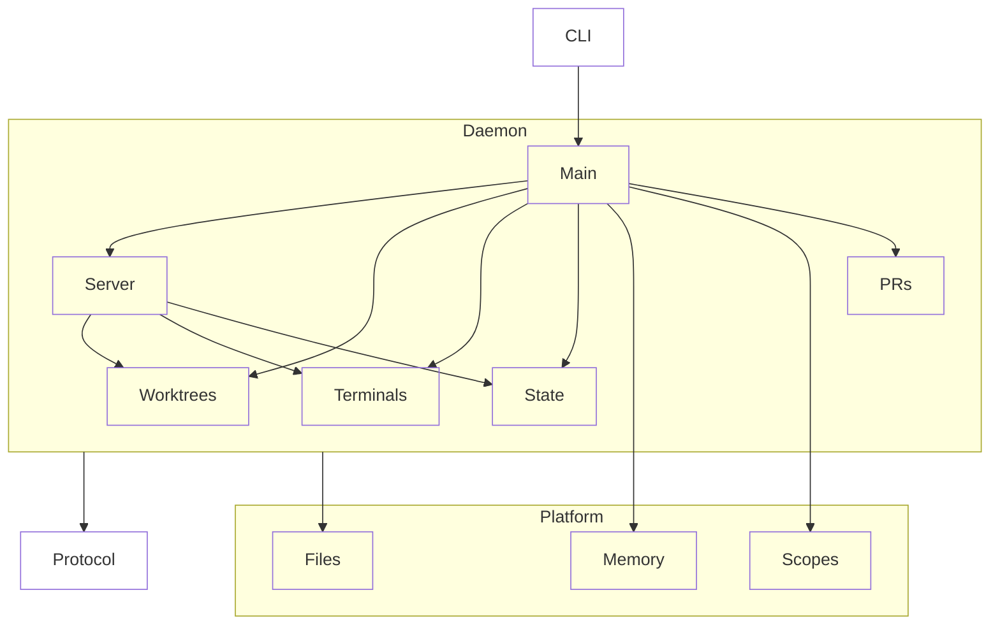

# Daemon

## Purpose & context

One per host. Owns PTYs, their headless screen mirrors, worktree watches and persisted layout and checkbox state; serves the protocol on an owner-only unix socket in `$XDG_STATE_HOME/worktree-term/run/`. Lives independently of any client.

## Building blocks

View `daemon`.

<!-- likec4:daemon -->

<!-- /likec4:daemon -->

## Principles

1. Its only listener is its owner-only unix socket. [enforced: test:test/process/daemon-server-startup.test.ts]
2. A PTY ends only by `closeTerm`, `removeWorktree` of its worktree, process exit or `shutdown`, never by a client leaving. [enforced: test:test/process/daemon-terminals-lifecycle.test.ts] [enforced: test:test/process/daemon-worktrees.test.ts]
3. PTY output is never dropped; backpressure pauses the PTY. [enforced: test:src/daemon/terminals/flow.test.ts] [enforced: test:test/process/daemon-terminals-output.test.ts]
4. An attach yields a snapshot and then live output with no gap and no duplicate byte. [enforced: test:test/process/daemon-terminals-output.test.ts]
5. Worktree changes are observed by events, never by polling; only forge state (≡ pull requests on the repo's git server) is polled, and only while its repo is watched. [review]
6. Persisted state references no worktree that is gone and has no terminals. [enforced: test:src/daemon/state/store.test.ts]
7. Each terminal runs in a scope of its own when a lasting user manager (≡ one the daemon runs under, or lingering) is reachable. [enforced: test:test/process/daemon-terminals-scopes.test.ts]
